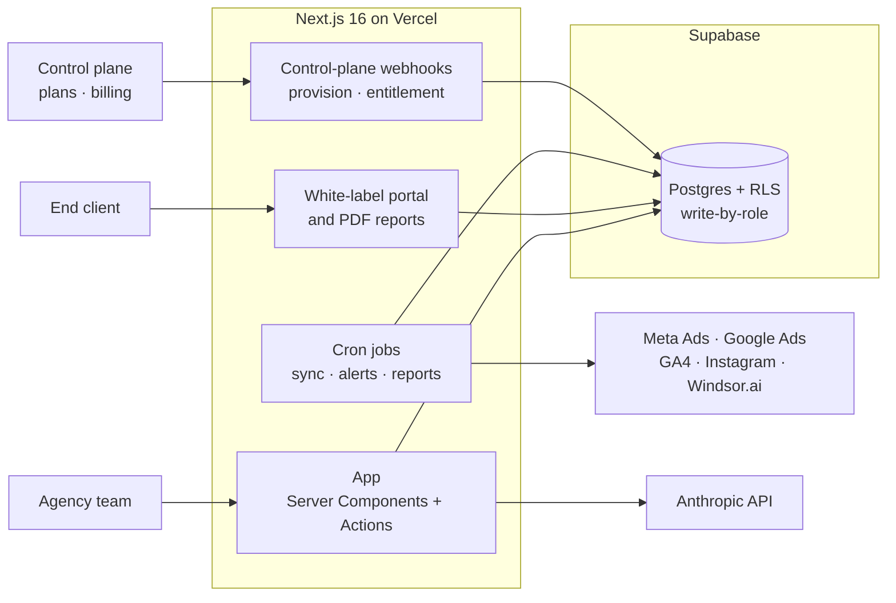

# Dash Centtra

**A marketing analytics SaaS for paid-traffic managers and agencies: every client's Meta Ads, Google Ads, GA4 and Instagram results in one place, with lead attribution, goals, alerts and white-label client reports.**

🌐 Live: [dash.centtra.com.br](https://dash.centtra.com.br) · 🇧🇷 In production

> **About this repository.** Dash Centtra is a commercial product, so its source code is private.
> This repository is a public showcase: it explains what the product does and how it is built, and it
> includes real modules from the codebase (with their tests) so you can judge the code itself.
> Access to the private repository can be granted during a hiring process. Just ask.

---

## The problem

A traffic manager handles many clients and lives in several ad dashboards at once. To answer "is this client's money
working?" they export spreadsheets, paste numbers into slides and lose the link between an ad and the sale it produced.
Dash Centtra connects to the ad platforms, puts every client in one portfolio view and turns the data into reports the
end client can open.

## What it does

| Area | Highlights |
|---|---|
| **Data sources** | Meta Ads, Google Ads, GA4 and Instagram, through the official APIs or Windsor.ai; scheduled syncs per tenant; credentials encrypted at rest (AES-256-GCM) |
| **Dashboards** | Portfolio view of all clients, a cockpit per client, breakdowns by campaign, ad set and creative, organic Instagram |
| **Attribution** | Lead and sales funnel per client, so spend is compared with real outcomes, not only clicks |
| **Goals & alerts** | Monthly goals with pacing, alerts when a metric drifts, and a seasonal calendar of retail dates that warns ahead of time |
| **Client delivery** | Scheduled PDF reports, a white-label client portal with embeddable blocks, and a meeting mode that builds the agenda and tracks what was agreed |
| **AI assistant** | Answers questions about the client's numbers (Anthropic API), with monthly limits per plan and add-on packs |
| **Platform** | Multi-tenant with roles (owner, manager, viewer, member), demo accounts by signed link, plans and billing driven by a separate control plane, web push notifications |

## Architecture



### Key engineering decisions

- **Pure logic, thin I/O.** Business rules such as pacing, alerts, meeting agendas, the seasonal calendar and ad ranking
  live in pure modules with no database or network access. Server code only reads, calls them and writes. That keeps
  most of the product testable in milliseconds.
- **Tenant isolation in Postgres.** Row Level Security restricts every row to its tenant and allows writes by role.
  Third-party credentials are encrypted with AES-256-GCM before they are stored.
- **Honest numbers.** Metrics are designed so they can't mislead: a commitment without a due date never counts as
  "overdue", division by zero never shows up as "infinite cost", and dates are computed in the São Paulo time zone.
- **Gating by plan from one place.** The AI assistant is the reference: monthly message limit, kill switch and model
  tier come from the plan pushed by the control plane, and they are checked again on the server.

## Stack

**Frontend:** Next.js 16 (App Router), React 19, TypeScript, Leaflet, TipTap
**Backend:** Supabase (Postgres, Auth, RLS), Server Actions, scheduled jobs
**Integrations:** Meta Marketing API, Google Ads API, GA4 Data API, Instagram Graph API, Windsor.ai, Anthropic API, Resend, Web Push
**Reports:** @react-pdf/renderer, ExcelJS
**Quality:** Vitest (~150 test files), GitHub Actions

## Code samples in this repository

These modules were copied from the production codebase, along with their original tests.
Comments and identifiers are mostly in Portuguese, the language of the product and its users.

| File | What it shows |
|---|---|
| [`samples/lib/sazonalidade/`](samples/lib/sazonalidade) | The seasonal calendar: Brazilian retail dates (fixed dates and Easter-based ones), each client's own dates, the timeline and the "it's coming up" warnings. Pure functions with scenario tests. |
| [`samples/lib/db/crypto.ts`](samples/lib/db/crypto.ts) | AES-256-GCM encryption for third-party API credentials |

```bash
npm install
npm test          # 95 tests
npm run typecheck
```

## Author

**Leandro Rocha** · civil engineer and software developer · Joinville, Brazil
I design, build and operate the Centtra products end to end, from database and architecture to UI.

---

### 🇧🇷 Resumo em português

O **Dash Centtra** é um SaaS de análise de marketing para gestores de tráfego e agências. Ele junta Meta Ads, Google Ads,
GA4 e Instagram de todos os clientes, com atribuição de leads, metas, alertas, relatórios e portal white-label para o
cliente final. O código é privado por ser um produto comercial. Este repositório mostra a arquitetura, as decisões
técnicas e módulos reais com testes. O acesso ao repositório privado pode ser liberado durante um processo seletivo.
